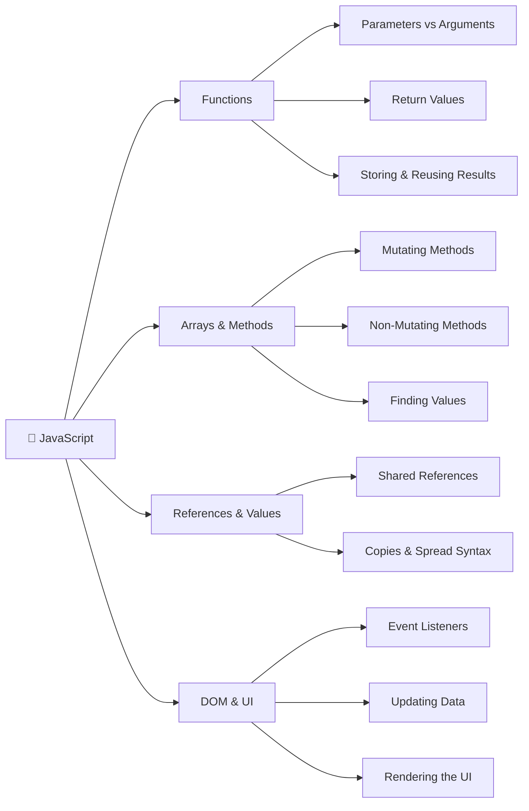
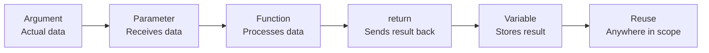

# 🧠 JavaScript Concept Mind Map

My evolving JavaScript reference guide for my Frontend Comeback journey.

## How JavaScript Concepts Connect



---

## 1. Functions: How Data Moves



### Example: Shopping Cart Total

```javascript
function calculateTotal(prices) {
  let total = 0;

  for (const price of prices) {
    total += price;
  }

  return total;
}

const cart = [5, 12, 3];
const cartTotal = calculateTotal(cart);

console.log(cartTotal); // 20
```

### How the pieces connect

| Concept        | Example                  | Meaning                              |
| -------------- | ------------------------ | ------------------------------------ |
| Function       | `calculateTotal()`       | Reusable instructions                |
| Parameter      | `prices`                 | Placeholder for incoming data        |
| Argument       | `cart`                   | Actual array passed to the function  |
| Local variable | `total`                  | Stores the running calculation       |
| Return value   | `return total`           | Sends the result back                |
| Stored result  | `cartTotal`              | Holds the returned number, `20`      |
| Reuse          | `console.log(cartTotal)` | Uses the result outside the function |

### Return vs. console.log()

- `console.log(value)` displays a value for debugging.
- `return value` sends a value back to the caller.
- A function without an explicit `return` returns `undefined`.
- A returned value can be stored, passed to another function, or used in an expression.

Key takeaway: return gives a function's result back to the caller. Storing that result in a variable lets us reuse it without running the function again, unless we need a fresh calculation.

### Functions: Mutation vs. Return

A function can modify data without returning a value.

```javascript
const cart = ['Coffee', 'Cookie'];

function addItem(items) {
  items.push('Sandwich');
}

const result = addItem(cart);

console.log(result); // undefined
console.log(cart); // ['Coffee', 'Cookie', 'Sandwich']
```

**Key takeaway:**

- `.push()` mutates the existing array.
- `items` and `cart` reference the same array.
- The function returns `undefined` because there is no `return` statement.
- Mutating data and returning a value are independent behaviors.

### Mutation vs. Creating a New Array

**Mutating approach:**

```javascript
function addItem(items) {
  items.push('Sandwich');
}
```

Changes the original array. The function returns `undefined`.

**Non-mutating approach:**

```javascript
function addItem(items) {
  return [...items, 'Sandwich'];
}
```

Creates and returns a new array. The original array stays unchanged.

**Key takeaway:** Returning a value and modifying existing data are separate decisions. Spread syntax allows us to create a new array instead of mutating the original.i think
