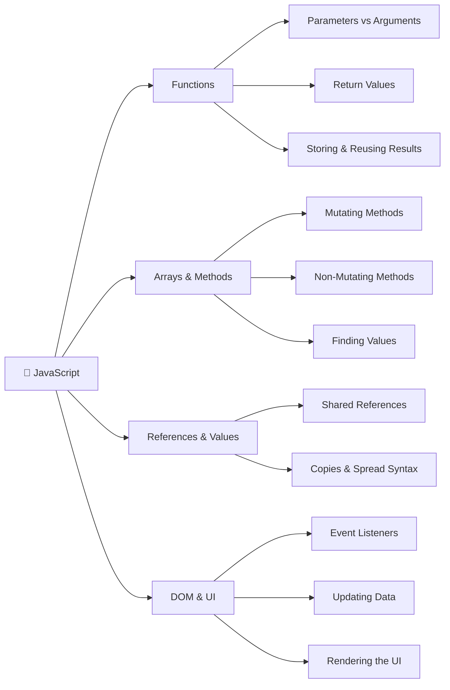
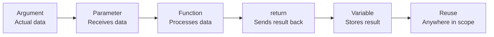
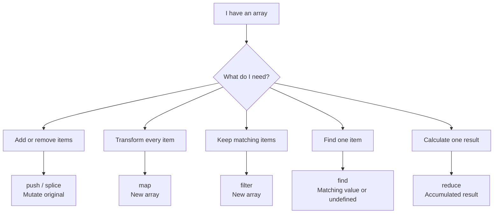
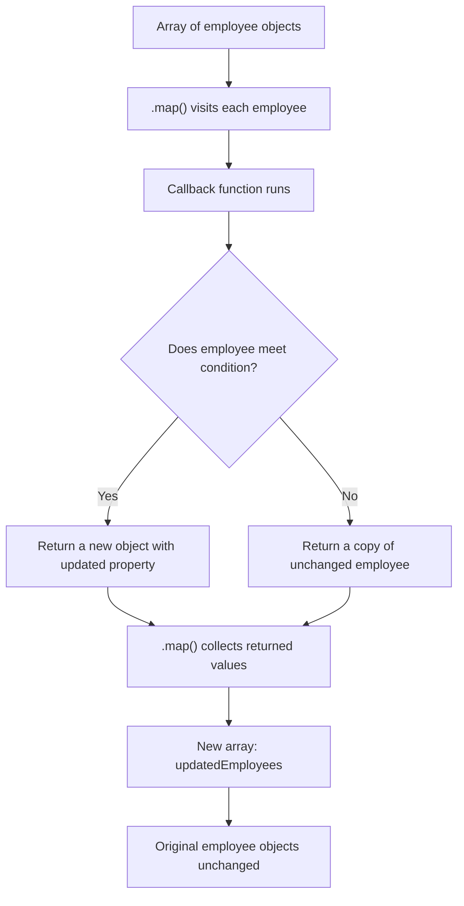

# 🧠 JavaScript Concept Mind Map

My evolving JavaScript reference guide for my Frontend Comeback journey.

## How JavaScript Concepts Connect



---

## 1. Functions: How Data Moves



### Example: Shopping Cart Total

```javascript
function calculateTotal(prices) {
  let total = 0;

  for (const price of prices) {
    total += price;
  }

  return total;
}

const cart = [5, 12, 3];
const cartTotal = calculateTotal(cart);

console.log(cartTotal); // 20
```

### How the pieces connect

| Concept        | Example                  | Meaning                              |
| -------------- | ------------------------ | ------------------------------------ |
| Function       | `calculateTotal()`       | Reusable instructions                |
| Parameter      | `prices`                 | Placeholder for incoming data        |
| Argument       | `cart`                   | Actual array passed to the function  |
| Local variable | `total`                  | Stores the running calculation       |
| Return value   | `return total`           | Sends the result back                |
| Stored result  | `cartTotal`              | Holds the returned number, `20`      |
| Reuse          | `console.log(cartTotal)` | Uses the result outside the function |

### Return vs. console.log()

- `console.log(value)` displays a value for debugging.
- `return value` sends a value back to the caller.
- A function without an explicit `return` returns `undefined`.
- A returned value can be stored, passed to another function, or used in an expression.

Key takeaway: return gives a function's result back to the caller. Storing that result in a variable lets us reuse it without running the function again, unless we need a fresh calculation.

### Functions: Mutation vs. Return

A function can modify data without returning a value.

```javascript
const cart = ['Coffee', 'Cookie'];

function addItem(items) {
  items.push('Sandwich');
}

const result = addItem(cart);

console.log(result); // undefined
console.log(cart); // ['Coffee', 'Cookie', 'Sandwich']
```

**Key takeaway:**

- `.push()` mutates the existing array.
- `items` and `cart` reference the same array.
- The function returns `undefined` because there is no `return` statement.
- Mutating data and returning a value are independent behaviors.

### Mutation vs. Creating a New Array

**Mutating approach:**

```javascript
function addItem(items) {
  items.push('Sandwich');
}
```

Changes the original array. The function returns `undefined`.

**Non-mutating approach:**

```javascript
function addItem(items) {
  return [...items, 'Sandwich'];
}
```

Creates and returns a new array. The original array stays unchanged.

**Key takeaway:** Returning a value and modifying existing data are separate decisions. Spread syntax allows us to create a new array instead of mutating the original.i think

---

## 2. Arrays & Methods: What Happens to the Data?



### Array Methods Reference

| Method      | Purpose                  | Mutates original? | Returns                      |
| ----------- | ------------------------ | ----------------- | ---------------------------- |
| `.push()`   | Add to end               | Yes               | New array length             |
| `.splice()` | Add/remove at an index   | Yes               | Array of removed items       |
| `.map()`    | Transform each item      | No                | New array                    |
| `.filter()` | Keep matching items      | No                | New array                    |
| `.find()`   | Find first matching item | No                | Matching item or `undefined` |
| `.reduce()` | Accumulate a result      | No                | Final accumulated value      |

### Chaining Methods

```javascript
const engineeringEmployees = employees
  .filter((employee) => employee.department === 'Engineering')
  .map((employee) => employee.name);

// ['Sarah', 'Alex']
```

**Key takeaway:** The returned value from one array method can become the input to another method. We can then store the final result and reuse it.

Always ask:

1. Why am I using this method?
2. Does it mutate the original array?
3. What does it return?
4. What will I do with the returned value?

### References: The Boxes and Items Mental Model

An array is a box. When its elements are objects, think of them as tickets pointing to objects.

```javascript
const sarah = { name: 'Sarah' };
const box1 = [sarah];
const box2 = [...box1];
```

- `box1` and `box2` are separate arrays.
- Both contain references to the same Sarah object.
- `[...box1]` copies the array, not Sarah herself.
- `{ ...sarah }` creates a new Sarah object (shallow copy).

**Changing a shared object:**

```javascript
box2[0].name = 'Samantha';
// Both arrays now see Samantha
```

**Replacing an array element:**

```javascript
box2[0] = { name: 'Samantha' };
// Only box2 points to the new object
```

These examples describe separate scenarios starting from the original arrays.

**Key takeaway:** Changing an object's property is different from replacing a reference to that object.

## 🧠 Reference Checklist

When copying or changing data, ask these four questions:

### 1. What kind of value am I working with?

- Primitive: string, number, boolean, null, undefined, etc.
- Reference type: object or array.

### 2. What is being copied?

- A primitive value?
- A reference to an existing object?
- A new array or object?

### 3. Are there nested objects or arrays?

- Spread creates a **shallow copy**.
- Nested objects and arrays may still share references.

### 4. Am I mutating or reassigning?

- Mutation changes an existing object or array.
- Reassignment changes what a variable points to.
- Replacing an array element changes which value is stored at that index.

### Common Gotchas

| Code                             | What happens                                      |
| -------------------------------- | ------------------------------------------------- |
| `const b = a` (objects)          | Both variables reference the same object          |
| `const b = { ...a }`             | New outer object; nested references may be shared |
| `const copy = [...employees]`    | New array; same employee objects                  |
| `employees.map(e => e)`          | New array; same employee objects                  |
| `employees.map(e => ({ ...e }))` | New array; new shallow copies of employee objects |
| `copy[0].name = 'Ellie'`         | Mutates the object at index 0                     |
| `copy[0] = { name: 'Ellie' }`    | Replaces the element at index 0                   |

**Remember:** A new array does not automatically mean new objects inside it.

## 🔗 Putting It Together: Array Methods + Functions + References



### Real Example: Employee Directory

```javascript
const updatedEmployees = employees.map((employee) => {
  if (employee.name === 'Sam') {
    return { ...employee, name: 'Ellie' };
  }

  return { ...employee };
});
```

### How the concepts connect

- **Array:** Holds the employee objects.
- **.map():** Creates a new array.
- **Callback:** Runs once for each employee.
- **Parameter:** `employee` represents the current item.
- **Conditional:** Decides which object to return.
- **Spread:** Creates a shallow copy of the employee object.
- **return:** Supplies the value that .map() places in the new array.
- **References:** Help explain why copied objects can be changed without mutating the originals (for these top-level properties).

**Key idea:** Every callback return becomes an element of the new array.
